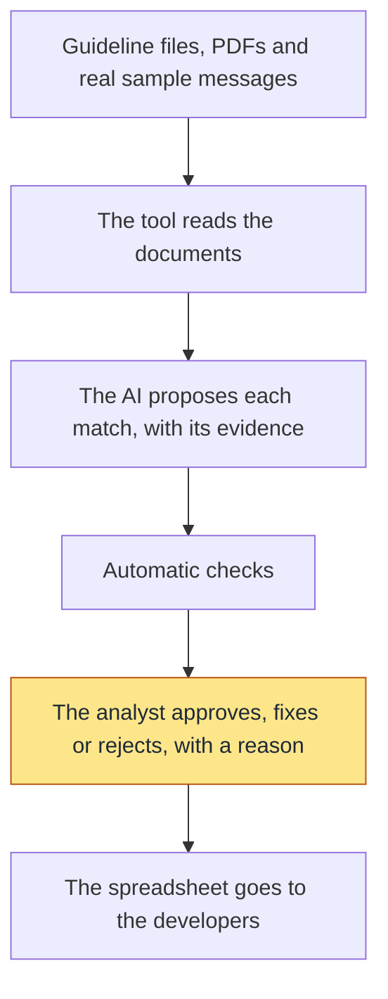

# Mapping Studio

**A 20-hour specialist job, drafted by AI in 8 minutes, then checked by an analyst.**

This repo is the case study. The code belongs to a client and stays private. The full story, with real screens and the analyst's voice note, is on my site: [arunbhisne.com/projects/mapping-studio](https://www.arunbhisne.com/projects/mapping-studio)

| | |
|---|---|
| **The job** | Matching a new customer's data fields to the company's own, by hand. One guide has 332 fields, many matched by meaning, not by name. |
| **Who uses it** | The integration analysts at a fast-growing logistics company |
| **My role** | Discovery to delivery. I designed it and directed the build, and AI coding agents wrote the code. |
| **Built in** | 9 days |
| **Today** | In production, on the company's own servers |

## What changed

| | By hand | With Mapping Studio |
|---|---|---|
| A full mapping draft | 20 to 24 hours | About 8 minutes, then checked by an analyst |
| Cost | Budget of $14 a mapping | Under $5 a draft |
| Quality | The bar was 60% right | Over 80% right |
| First live run | | 811 of 813 automated checks passed |

**How these were measured.** 20 to 24 hours is an analyst's estimate, recorded during my research. 8 minutes is the tool's own timing on a full 332-field draft. Under $5 is the measured cost of a full run. Over 80% is the analyst team's own check. The $14 budget and the 60% bar come from the client's brief.

## I watched a mapping happen before I designed anything.

A senior analyst read one of my LinkedIn posts and asked if AI could take on his team's slowest job. They had already tried ChatGPT and Gemini. The files were too big, so the chats ran out of room and handed back half answers.

So I sat with an analyst and watched one. A mapping is a translation guide. A customer describes a shipment in their language, the company describes it in its own, and an analyst matches every field between the two. Mapping also comes first, so customer meetings, development, testing and go-live all wait for it.

*My research sketch of the onboarding workflow. The sticky notes mark mapping as the first bottleneck.*

## How it works

The tool has hard lines. It drafts, but it never runs anything in production, never approves its own work, and never learns without a person signing off.

It writes its draft into the same spreadsheet layout the team already hands to developers, so nothing downstream had to change. Four readers cover every combination of message formats the company deals with (X12, EDIFACT, XML and JSON), 15 in all.

## Decisions I made

**1. A step-by-step tool, with AI only where judgement is needed.**
I looked at five ways to fix the problem: more analysts, matching rules, a chat AI, one free-running AI agent, or a step-by-step tool. Only the last one is predictable, and every step in it can be checked.

**2. Every answer shows its evidence.**
On day one the analyst didn't believe AI could do this. So beside each proposed match, the tool shows the guideline's own note, a value from a real sample message, and how an analyst mapped it before. The analyst checks the source, not the AI's word. That panel won the sceptics over.

*One proposed match, with the evidence the analyst checks it against.*

**3. A review tool, not an autopilot.**
Where two models disagreed, my answer key could settle only 2 of 81 cases. So the AI drafts, flags what it isn't sure of, and the analyst decides. When the tool can't find a match, it says why.

**4. It should feel like their own software.**
The first version's output was good, and the room went quiet. Nobody used it. So I went back and watched them work. They spend their whole day in one piece of software, and mine looked nothing like it. I rebuilt it with the same colours and fonts, and they started reading every draft and using it.

**5. Move the AI onto the company's own servers.**
One of the company's customers asked how their data stays safe. I decided to move the AI off the cloud, and the company's IT team deployed it on their own servers with a locally hosted model. The answers stayed the same when we re-ran the test files. We traded a little speed for complete control of the data.

## How I worked

Every project I run has a written brief, a definition of done and a decision log. I designed the tool and directed the build with AI coding agents (Claude Code, Cursor).

An automatic score can't tell a good mapping from one that only looks right. So the experts graded the drafts field by field, and only the AI's untouched work counts toward quality.

Then I handed it over in person to the company's AI architect and walked him through every part of it. He runs it now.

## About the code

The code belongs to the client, so it stays private. If you want to see how it was built, I'm happy to walk you through it on a call: the brief, the decisions and the checks.

## What's next

After a mapping is signed off, a developer codes it into the system. That's the next step worth automating. I'd also add evaluation agents that check each draft before an analyst sees it.

---

**Arun Bhisne** · AI Solutions Designer-Builder · [arunbhisne.com](https://www.arunbhisne.com) · [LinkedIn](https://www.linkedin.com/in/arunbhisne)
